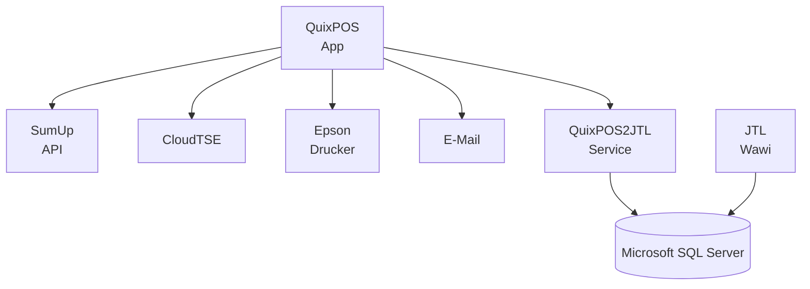

# Übersicht

QuixPOS kann seine Daten aus einem JTL Backend beziehen oder aus einer eigenen Artikel- und Auftragsverwaltung.

---

## Architektur auf einen Blick

---

## Komponenten im Detail

### 🗄️ Microsoft SQL Server

Das Fundament der Artikelverwaltung ist ein **Microsoft SQL Server** mit JTL-Wawi oder QuixPOS Datenbank.

---

### 🔄 QuixPOS2JTL oder QuixSYNC – Dienst

**QuixPOS2JTL** ist ein Windows-Dienst (alternativ als Linux-Node.js-Prozess), der als **Brücke zwischen dem SQL Server und den Kassen-Clients** fungiert.

Er stellt eine **REST-API** bereit, über die QuixPOS folgende Daten synchronisiert:

| Datenkategorie | Richtung | Beschreibung |
| :--- | :--- | :--- |
| Artikel | SQL → Kasse | Produktnummern, Bezeichnungen, Barcodes |
| Preise | SQL → Kasse | Kunden- und Standardpreise |
| Bilder | SQL → Kasse | Artikelbilder für die Kassenoberfläche |
| Kunden | SQL → Kasse | Kundenstamm für Kundenbindung & Rechnungen |
| Bestandsbuchungen | Kasse → SQL | Abgeschlossene Kassiervorgänge |
| Bons / Tagesabschlüsse | Kasse → Email (Sync–Dienst unabhängig) | Bon-Daten für das Kassenbuch |

---

### 💳 SumUp – Kartenzahlung

QuixPOS ist direkt mit der **SumUp API** integriert und unterstützt folgende gängigen SumUp-Terminals:

- **SumUp Air** – Bluetooth / WLAN
- **SumUp Solo Lite** – Bluetooth / WLAN
- **SumUp Solo** – Bluetooth / WLAN oder CloudSDK (dafür muss die Kasse und das Solo für sich mit dem Internet verbunden sein, ohne das beide Geräte direkt verbunden sind)

Der Zahlungsvorgang läuft direkt aus der Kassenoberfläche heraus ab. Die SumUp-Integration erfordert einen SumUp-Händler-Account und wird in den QuixPOS-Einstellungen mit dem API-Key verknüpft. QuixPOS Web funktionier nur mit SumUp Solo / CloudSDK.

---

### 🔐 Technische Sicherheitseinrichtung

In Deutschland ist jede Kasse gesetzlich verpflichtet eine **Technische Sicherheitseinrichtung (TSE)** zu verwenden. QuixPOS unterstützt TSE Module auf SD Karte oder USB Stick.

---

### 🖨️ Epson Bon-Drucker

QuixPOS unterstützt **Epson ESC/POS-kompatible Thermo-Bondrucker** (z. B. Epson TM-T30iii, TM-T88-Serie) über Netzwerk (LAN/WLAN)

---

## 💬 Technischer Support & Community

Bei Fragen zur Einrichtung, Konfiguration oder Problemen bieten wir technischen Support über unseren Discord-Server:

👉 **[Technischer Support auf Discord](https://discord.gg/5ftjruDFJ)** (`https://discord.gg/5ftjruDFJ`)

Hier erreichst du direkt die Entwickler und kannst dich mit anderen QuixPOS-Nutzern austauschen.
